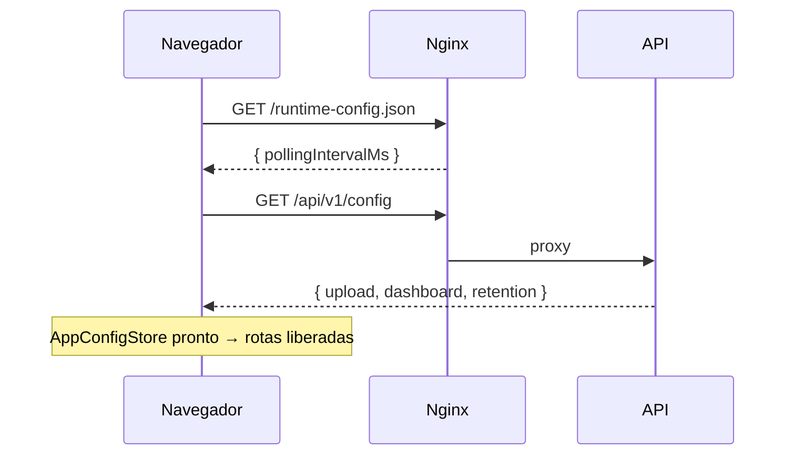

# Plan — JMC AI Analyzer Web v0.1.0

| Campo | Valor |
|---|---|
| Versão | 0.1.0 |
| Data | 2026-11-17 |
| Spec | [spec.md](spec.md) |
| Tarefas | [tasks.md](tasks.md) |
| Fonte | Notas Obsidian em `jmc-ai-analyzer-web/v0.1.0/` (02, 05, 06, 07, 08, 09) |

> Este plano descreve **como** implementar a [spec](spec.md). Desvios precisam ser **combinados com o autor**.

---

## 1. Stack

| Item | Escolha | Versão (npm, 2026-11-17) |
|---|---|---|
| Framework | Angular (standalone, signals, zoneless, `@if`/`@for`) | 22.2.x |
| CLI | `@angular/cli` | 22.2.x |
| UI | Angular Material (tema M3) | 22.2.x |
| Gráficos | `ngx-echarts` + `echarts` | 22.0.x / 6.1.x |
| Tipos da API | `openapi-typescript` | 7.13.x |
| Testes unitários | Vitest (runner da CLI) + `@vitest/coverage-v8` + Angular Testing Library | 5.1.x |
| E2E | `@playwright/test` + `@axe-core/playwright` | 1.65.x |
| Lint | `angular-eslint` + Prettier | 22.7.x |
| Fontes | `@fontsource/inter`, `@fontsource/jetbrains-mono` | — |
| Node (build) | Node 24 LTS | 24.x |
| Servidor | `nginx:alpine` (não-root) | — |

As versões exatas ficam no `package.json` gerado pela CLI (T-W01.1). Nenhuma biblioteca de estado (NgRx) é usada.

## 2. Estrutura

```text
.
├── .spec/0.1.0/                  SDD
├── jmc-ai-analyzer-web/v0.1.0/   notas Obsidian (fonte de verdade de produto)
├── docker/                       nginx.conf, entrypoint (runtime-config.json)
├── e2e/                          testes Playwright e fixtures
├── public/                       favicon e logos (de jmc-ai-analyzer-web/v0.1.0/assets)
├── src/
│   ├── main.ts · styles.scss
│   ├── styles/                   _tokens.scss (cores, fontes), _theme.scss (Material M3 claro/escuro)
│   └── app/
│       ├── app.config.ts · app.routes.ts · app.ts
│       ├── core/
│       │   ├── api/              analyses-api.ts, recordings-api.ts, software-api.ts, config-api.ts, health-api.ts
│       │   │   ├── models.ts     aliases dos tipos gerados e tipos das séries
│       │   │   └── generated/    api.d.ts (openapi-typescript; não editar)
│       │   ├── config/           app-config.store.ts (GET /config + runtime-config), app-initializer
│       │   ├── errors/           api-error.ts, error-messages.ts (code → pt-BR)
│       │   ├── interceptors/     problem-json.interceptor.ts
│       │   ├── layout/           shell, toolbar, nav, api-health-indicator, theme-toggle
│       │   └── theme/            theme.service.ts (sistema / claro / escuro)
│       ├── shared/
│       │   ├── components/       health-badge, priority-chip, coverage-status, stack-trace, app-frame,
│       │   │                     copy-button, empty-state, error-state, loading-state
│       │   ├── charts/           time-series-chart, ranking-bar-chart, chart-theme.ts
│       │   └── pipes/            bytes, duration, cpu-percent, relative-time, frame
│       └── features/
│           ├── upload/           upload.page, file-drop, upload.store
│           ├── batch-status/     batch-status.page, batch-status.store (polling)
│           ├── dashboard/        blocos compartilhados pelos dois dashboards
│           │   ├── blocks/       diagnosis, coverage, cpu, heap, gc, threads, locks, hot-methods,
│           │   │                 allocation, exceptions, io, leaks, thread-cpu, findings, metadata
│           │   └── comparison/   tabela do lote
│           ├── recording-dashboard/  page + store
│           ├── batch-dashboard/      page + store
│           ├── history/          history.page, history.store
│           ├── software/         software.page, software-edit.dialog, software.store
│           └── not-found/
├── proxy.conf.json · angular.json · vitest.config.ts · playwright.config.ts
├── eslint.config.js · sonar-project.properties · Dockerfile · .dockerignore
└── package.json
```

**Convenções**:
- Componentes standalone, `ChangeDetectionStrategy.OnPush`, `input()`/`output()`, `inject()`.
- **Páginas** coordenam e **stores** guardam estado; **componentes de apresentação** não fazem HTTP.
- Nomes de arquivo em `kebab-case` com sufixo de papel (`.page.ts`, `.store.ts`, `.api.ts`, `.pipe.ts`).
- Textos em pt-BR num único lugar por feature (`*.texts.ts`), mensagens de erro em `core/errors`.
- Complexidade cognitiva ≤ 15; sem `any`; sem `console`.

## 3. Configuração e inicialização



- `provideAppInitializer` carrega as duas configurações. Se `/api/v1/config` falhar, usa os padrões (20 arquivos, 128 MB, 1 GB, topN 10/50) e marca a API como indisponível no shell.
- `runtime-config.json` é gerado pelo `docker/entrypoint.sh` a partir de `POLLING_INTERVAL_MS`. Em desenvolvimento, `public/runtime-config.json` tem o padrão.

## 4. Camada de API

- Um serviço por recurso em `core/api`, tipado com `components['schemas'][...]` de `api.d.ts`:
  - `AnalysesApi`: `upload(form): Observable<HttpEvent<BatchResponse>>`, `status(id)`, `dashboard(id, topN)`, `history(filtro, página)`;
  - `RecordingsApi`: `dashboard(id, topN)`;
  - `SoftwareApi`: `list()`, `update(name, patch)`;
  - `ConfigApi`, `HealthApi`.
- **Upload**: `FormData` com `software`, `softwareVersion`, `environment`, `description` e `files[]`; `reportProgress: true`, `observe: 'events'`.
- **Interceptor** `problemJsonInterceptor`: converte `HttpErrorResponse` em `ApiError { status, code, detail, properties }`. Erro de rede vira `code = 'NETWORK'`.
- **Séries genéricas**: se o spike T-W02.1 mostrar que o OpenAPI gerado não descreve bem `CpuView<S>`, `HeapView<S>` e `ThreadsView<S>`, tipar em `models.ts`:
  ```ts
  type MetricSeries = Partial<Record<MetricType, Point[]>>;           // gravação
  type BatchSeries = Record<string /* recordingId */, MetricSeries>;  // lote
  ```
- **Contrato**: `npm run api:types` (com a API no ar) regenera `api.d.ts`; `npm run api:check` gera em arquivo temporário e falha se houver diferença.

## 5. Estado (stores com signals)

| Store | Estado | Comportamento |
|---|---|---|
| `AppConfigStore` | limites, polling | carregado no initializer |
| `UploadStore` | arquivos com validação, progresso, erro | valida com o `AppConfigStore`; cancela pela assinatura |
| `BatchStatusStore` | lote, erro, falhas seguidas | `timer` + `switchMap`; pausa com `visibilitychange`; para fora de `PROCESSING` e no `DestroyRef` |
| `RecordingDashboardStore` / `BatchDashboardStore` | dashboard, `topN`, carregando, erro | `topN` sincronizado com a query string |
| `HistoryStore` | página, filtro | filtro e página na query string |
| `SoftwareStore` | lista, salvando | `PATCH` otimista, desfeito se a API recusar |

Padrão: `signal` para o estado bruto, `computed` para os derivados (contagem por prioridade, blocos disponíveis) e `rxResource`/`httpResource` quando couber.

## 6. Dashboard

- Os blocos de `features/dashboard/blocks` recebem dados por `input()` e servem aos dois dashboards. Os blocos com série recebem `Series[]` já normalizadas (uma série por métrica na gravação; por gravação no lote).
- **Âncoras**: cada bloco tem `id` = `domainRef` (`cpu`, `heap`, `gc`, `threads`, `locks`, `hotMethods`, `allocation`, `exceptions`, `io`, `leakSuspects`, `threadCpu`, `findings`, `metadata`, `coverage`). "Ver dados" usa `ViewportScroller` e atualiza o fragmento da URL.
- **`appFrame`**: componente `app-frame` mostra `Classe.metodo:linha`, o pacote recolhido e o botão de copiar. `stack-trace` mostra os 5 frames, destacando o `appFrame`.
- **Achados do JMC**: `[innerHTML]` com o sanitizador padrão do Angular; nenhum `bypassSecurityTrust*`.
- **Selo de saúde**: componente puro em CSS (`conic-gradient`), sem ECharts.

## 7. Gráficos

- `ngx-echarts` com `provideEchartsCore({ echarts: () => import('echarts/core') })` e registro só dos componentes usados (LineChart, BarChart, Grid, Tooltip, Legend, DataZoom, Aria, CanvasRenderer), para reduzir o bundle.
- `chart-theme.ts` lê os tokens CSS (`getComputedStyle`) e reage à troca de tema.
- `time-series-chart`: `avg` como linha e `max` como faixa clara (`areaStyle` entre as séries); `dataZoom` interno; tooltip com data local; unidade (`percent`, `bytes`, `count`) formatada pelos pipes.
- `ranking-bar-chart`: barras horizontais ordenadas, rótulos truncados com tooltip completo e marcador nos itens com `appFrame` próprio.
- Cada gráfico tem um `<p class="sr-summary">` com o resumo em texto, gerado pelo mesmo `computed` que monta as opções.

## 8. Identidade visual

- `styles/_tokens.scss` define as variáveis CSS da nota 09 para claro e escuro (`:root` e `.theme-dark`, alternados pelo `ThemeService`, com `prefers-color-scheme` como padrão).
- `styles/_theme.scss`: tema Material M3 com a cor primária derivada de `#0B5563` e tipografia Inter.
- Fontes via `@fontsource`, importadas em `styles.scss`.
- Logos de `jmc-ai-analyzer-web/v0.1.0/assets/` copiados para `public/` (favicon gerado do `logo-mark.svg`).
- **Layout** (`app.html`/`app.scss`): grade com barra superior, menu e `<main id="conteudo">`; `body` com `overflow: hidden` e altura `100dvh`, então só o `main` rola. `main` tem `position: relative` para conter elementos absolutos (ex.: `.sr-only`), que de outro modo esticariam a janela.
- **Rolagem**: `ContentScroller` (`core/layout/content-scroller.ts`) substitui o `ViewportScroller` e rola o `main`; o roteador continua cuidando de âncoras, topo e restauração.
- **Utilitários globais** (`styles.scss`): `.page`, `.page-head`, `.eyebrow`, `.panel`, `.btn`, `.control`, `.kpi-grid`/`.kpi`, `.table-wrap`, `table.data.stack` (vira cartões abaixo de 640 px, com `data-label`), `.reveal`, `.skeleton` e as `@keyframes`.
- **Ícones**: `shared/components/icon.ts` (SVG de traço desenhados no app).
- **Dashboard**: `DashboardSummary` (KPIs de relance), `SectionNav` (barra de seções fixa com marcação da seção visível pela posição de rolagem) e filtro por prioridade no `DiagnosisList`.

## 9. Infraestrutura

### 9.1. Dockerfile (multi-stage)

1. **build**: `node:24-alpine`, `npm ci`, `npm run build`.
2. **runtime**: `nginx:alpine` rodando como não-root na porta 8080, com `docker/nginx.conf`, `docker/entrypoint.sh` (gera `runtime-config.json` e aplica `API_UPSTREAM` via `envsubst`) e `HEALTHCHECK` em `/healthz`.

### 9.2. Nginx

- `try_files $uri $uri/ /index.html`.
- `location /api/` e `location = /actuator/health` → `proxy_pass ${API_UPSTREAM}`, com `client_max_body_size 1g`, `proxy_request_buffering off` e `proxy_read_timeout 300s`.
- `location = /healthz` → `200`.
- Arquivos com hash: `Cache-Control: public, max-age=31536000, immutable`; `index.html` e `runtime-config.json`: `no-cache`.
- Cabeçalhos: `Content-Security-Policy: default-src 'self'; img-src 'self' data:; style-src 'self' 'unsafe-inline'; font-src 'self'`, `X-Content-Type-Options: nosniff`, `Referrer-Policy: same-origin`.
- Logs em `/var/log/nginx` (bind mount `${DATA_DIR}/frontend/logs`).

### 9.3. Compose (repositório da API)

O bloco `frontend` do `docker-compose.yml` da API é ativado (ver nota 07 do front). Variáveis: `API_UPSTREAM`, `FRONTEND_PORT` (padrão 4200) e `FRONTEND_POLLING_INTERVAL_MS`. O `scripts/init-data-dirs.sh` da API já cria `${DATA_DIR}/frontend`; falta criar `frontend/logs` com permissão para o usuário do Nginx (T-W08.3).

### 9.4. Desenvolvimento

`npm start` = `ng serve --proxy-config proxy.conf.json` (`/api` e `/actuator` → `http://localhost:8080`), com a API rodando via Compose da API.

## 10. Qualidade

| Item | Configuração |
|---|---|
| Vitest | `coverage.provider: 'v8'`, `reporter: ['text', 'lcov']`, `thresholds: { lines: 90, branches: 90 }`; exclui `main.ts`, `app.config.ts`, `*.routes.ts`, `core/api/generated/**`, `*.texts.ts` |
| Fixtures | respostas reais da API (dashboard, lote, histórico) geradas a partir dos 3 `.jfr` de exemplo, em `src/testing/fixtures/*.json` |
| Playwright | sobe o Compose da API com o front (`e2e:up`), envia os `.jfr` de exemplo e cobre CA-W01 a CA-W09, CA-W13 e CA-W14; `@axe-core/playwright` para o CA-W12 |
| ESLint | `angular-eslint` (recommended + template accessibility) + `@typescript-eslint/strict`; complexidade cognitiva via `eslint-plugin-sonarjs` |
| Sonar | `sonar-project.properties`: `sonar.sources=src`, `sonar.exclusions=src/app/core/api/generated/**`, `sonar.javascript.lcov.reportPaths=coverage/lcov.info`, `sonar.qualitygate.wait=true` |

## 11. Decisões

| # | Decisão | Motivo |
|---|---|---|
| W-D01 | Angular 22.2 + Material + ngx-echarts | previsto no desenho original do projeto |
| W-D02 | Repositório próprio; notas e SDD nele | pedido do autor |
| W-D03 | 6 telas na v0.1.0 | pedido do autor |
| W-D04 | Proxy na mesma origem | API sem CORS; uma origem só |
| W-D05 | Tipos gerados do OpenAPI | evitar divergência de contrato |
| W-D06 | Stores com signals, sem NgRx | estado local por tela |
| W-D07 | 90% de cobertura e Sonar | mesmo padrão da API |
| W-D08 | Front no Compose da API | uma única pilha local |
| W-D09 | Limites de `GET /api/v1/config` | uma fonte de configuração (endpoint já criado na API) |
| W-D10 | Identidade "diagnóstico clínico" | ler o JMC de relance |
| W-D11 | Navegadores modernos (`browserslist` padrão) | resposta do autor |
| W-D12 | Saúde: < 40 crítico, 40–74 atenção, ≥ 75 ok | resposta do autor |

## 12. Riscos

| Risco | Mitigação |
|---|---|
| OpenAPI impreciso para as séries genéricas | spike T-W02.1; tipos manuais em `models.ts` ou ajuste A4 na API |
| Bundle grande por causa do ECharts | import modular e rotas lazy; orçamento no `angular.json` |
| Upload de 1 GB pelo Nginx | `proxy_request_buffering off` e `client_max_body_size 1g`; teste E2E com arquivo grande gerado |
| 90% de branches em componentes visuais | lógica em `computed`/funções puras testáveis; templates finos |
| Mensagens do JMC em inglês nos achados sem tradução | mostradas como estão, identificadas como "texto original do JMC" |

## 13. Ajustes feitos durante a implementação

| Item | Plano | Implementado | Motivo |
|---|---|---|---|
| Tipos genéricos das séries (T-W02.1) | possível tipagem manual ou ajuste A4 | **não precisou**: o springdoc gerou `CpuViewMapMetricTypeListPoint` e `...MapUUIDMap...` distintos | spike com a API real |
| `openapi-typescript` | dependência de desenvolvimento | executado via `npx` (`api:types`, `api:check`) | exige TypeScript 5; o Angular 22 usa a 6 |
| Estado remoto | `rxResource`/`httpResource` | helper `Remote<T>` com signals + `HttpClient` | mais simples de testar com `HttpTestingController` |
| ECharts sob demanda | `import('echarts/core')` | `echarts-setup.ts` registra os módulos e reexporta `echarts/core` | o ngx-echarts espera o objeto do ECharts, não o módulo |
| Fontes | `@use` no SCSS | arquivos do `@fontsource` em `angular.json` (`styles`) | o Sass não importa `.css` com nome numérico |
| Rolagem até `#bloco` | `withInMemoryScrolling` | + `scrollToFragmentWhenReady` com offset da barra fixa | os blocos só existem depois da resposta da API |
| Diálogo de software e selects | Angular Material | diálogo e `select` nativos acessíveis | menos peso e o axe aprova nos dois temas |
| Selo de saúde | — | `role="img"` com `aria-label` | o axe proíbe `aria-label` em `div` sem papel |
| API retorna `null` | tipos gerados só com `?` | código usa `??` e verificação de `null`/`undefined` | o OpenAPI não marca campos anuláveis |
| Upload duplicado | — | o mesmo arquivo (nome + tamanho) não entra duas vezes | evita lote com arquivo repetido |
| E2E | Playwright | usa o Chrome instalado (`channel: 'chrome'`), sem baixar navegadores | ambiente local |
| Rolagem com menus fixos (W-D13) | rolagem da janela + offset da barra | `ContentScroller` rola o `main`; `ANCHOR_OFFSET` desconta a barra de seções | pedido de menus fixos com rolagem só no meio |
| Animações | — | CSS puro, `animation-fill-mode: backwards` | com `both`, o `transform` final criava um bloco de contenção e o diálogo `fixed` ficava preso dentro da página |
| Tabelas com rolagem lateral | — | `.table-wrap` com `tabindex="0"`, `role="region"` e `aria-label` | o axe exige que região rolável seja alcançável pelo teclado |
| Estilos dos blocos | um `blocks.scss` | `diagnosis-list.scss` separado | orçamento de 6 kB de estilo por componente |
| CSS global no build de produção | padrão do Angular (CSS crítico inline) | `optimization.styles.inlineCritical: false` no `angular.json` + E2E que confere um estilo global | o Angular carrega o `styles.css` com `media="print"` e troca por um `<script>` inline; a CSP do Nginx (`script-src 'self'`) bloqueia o script e o CSS global nunca era aplicado |
| Clone no Windows | — | o `Dockerfile` remove `\r` do `40-runtime-config.sh` e do template do Nginx; `.gitattributes` força LF | com CRLF, o `#!/bin/sh\r` dava `not found` e o `frontend` reiniciava sem parar |
| Teclado com menus fixos | — | foco no `main` a cada troca de caminho (não de query/fragmento) | com o `body` sem rolagem, PageDown/Espaço não faziam nada até clicar no conteúdo |
| Seção visível na barra | `IntersectionObserver` | posição de rolagem do `main` (`requestAnimationFrame`) | o observador marcava a seção anterior quando o bloco era alto |

