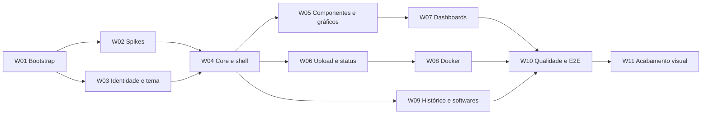

# Tasks — JMC AI Analyzer Web v0.1.0

| Campo | Valor |
|---|---|
| Versão | 0.1.0 |
| Data | 2026-11-17 |
| Spec | [spec.md](spec.md) |
| Plano | [plan.md](plan.md) |

## Como usar

- Cada tarefa tem um id `T-WEE.N`, as dependências (**Dep**) e o **Pronto quando**.
- Toda tarefa de código só está pronta com testes, cobertura mantida ≥ 90% e lint sem erros.
- `CA-Wxx` são os critérios de aceite da spec (§8).
- Em caso de dúvida, **pergunte ao autor** antes de decidir.
- Pré-requisito do repositório da API, já feito: `GET /api/v1/config` (T-14.1 da API).

## Ordem dos épicos

---

## W01 — Bootstrap

- [x] **T-W01.1 — Projeto Angular 22**: `ng new` (standalone, SCSS, roteamento, zoneless), Angular Material, ngx-echarts + echarts, `@fontsource/*`; fixar as versões no `package.json`.
  - **Dep**: — · **Pronto quando**: `npm run build` e `npm test` passam no projeto vazio.
- [x] **T-W01.2 — Qualidade no build**: Vitest com cobertura v8 e `thresholds` 90/90; ESLint (`angular-eslint`, `@typescript-eslint/strict`, `sonarjs`) e Prettier; `sonar-project.properties`.
  - **Dep**: T-W01.1 · **Pronto quando**: `npm run test:ci` falha abaixo de 90% e `npm run lint` roda.
- [x] **T-W01.3 — Estrutura e scripts**: pastas do plan §2; scripts `start`, `build`, `test`, `test:ci`, `lint`, `api:types`, `api:check`, `e2e`, `verify`; `proxy.conf.json`; `.gitignore` (`node_modules`, `dist`, `coverage`, `.angular`, `.idea/workspace.xml`); README.
  - **Dep**: T-W01.1 · **Pronto quando**: `npm start` abre o app com o proxy para a API local.

## W02 — Spikes

- [x] **T-W02.1 — Tipos do OpenAPI**: gerar `api.d.ts` da API rodando no Compose e conferir `RecordingDashboard`, `BatchDashboard`, `CpuView`, `HeapView` e `ThreadsView`. Se as séries vierem imprecisas, tipar em `models.ts` (plan §4) ou **propor ao autor** o ajuste A4 na API.
  - **Dep**: T-W01.3 · **Pronto quando**: `models.ts` compila com os dois formatos de série e `api:check` passa.
- [x] **T-W02.2 — Fixtures reais**: com a API no Compose, enviar os 3 `.jfr` de exemplo e um lote com arquivo truncado; salvar as respostas (status, dashboards, histórico, software, config) em `src/testing/fixtures/`.
  - **Dep**: T-W02.1 · **Pronto quando**: fixtures versionadas e carregadas num teste.

## W03 — Identidade e tema

- [x] **T-W03.1 — Tokens e tema**: `_tokens.scss` (paleta clara e escura da spec §7.1), `_theme.scss` (Material M3 com primária `#0B5563`), fontes Inter e JetBrains Mono.
  - **Dep**: T-W01.1 · **Pronto quando**: página de exemplo nos dois temas, conferida contra `identidade-preview.html`.
- [x] **T-W03.2 — Logos e favicon**: copiar `logo.svg` e `logo-mark.svg` para `public/`; gerar favicon e ícones.
  - **Dep**: T-W01.1 · **Pronto quando**: favicon e logo aparecem no shell.
- [x] **T-W03.3 — `ThemeService`**: sistema, claro e escuro, com a escolha salva no `localStorage`.
  - **Dep**: T-W03.1 · **Pronto quando**: testes de alternância e de persistência.

## W04 — Core e shell

- [x] **T-W04.1 — Clientes da API** (`AnalysesApi`, `RecordingsApi`, `SoftwareApi`, `ConfigApi`, `HealthApi`).
  - **Dep**: T-W02.1 · **Pronto quando**: testes com `HttpTestingController` para cada chamada, incluindo o progresso do upload.
- [x] **T-W04.2 — Erros**: `ApiError`, `problemJsonInterceptor`, `error-messages.ts` com todos os códigos da spec §6 e `NETWORK`.
  - **Dep**: T-W04.1 · **Pronto quando**: um teste por código, com placeholders preenchidos (`{maxFiles}`, `{limite}`).
- [x] **T-W04.3 — Configuração**: `AppConfigStore` e initializer (`/runtime-config.json` e `GET /api/v1/config`, com padrões em caso de falha).
  - **Dep**: T-W04.1 · **Pronto quando**: testes de sucesso e de fallback; CA-W13 (parte unitária).
- [x] **T-W04.4 — Shell**: toolbar com logo, `api-health-indicator` (a cada 30 s), `theme-toggle`, navegação lateral, rotas lazy, página "não encontrado" e aviso global.
  - **Dep**: T-W03.3, T-W04.3 · **Pronto quando**: navegação por teclado ok; CA-W14 (parte unitária).

## W05 — Componentes e gráficos compartilhados

- [x] **T-W05.1 — Pipes**: `bytes`, `duration`, `cpu-percent`, `relative-time`, `frame` (spec §7.3).
  - **Dep**: T-W01.1 · **Pronto quando**: testes com limites e valores nulos.
- [x] **T-W05.2 — Componentes**: `health-badge` (faixas da W-D12), `priority-chip`, `coverage-status`, `app-frame`, `stack-trace`, `copy-button`, `empty-state`, `error-state`, `loading-state`.
  - **Dep**: T-W03.1, T-W05.1 · **Pronto quando**: testes de componente e ícone + texto além da cor.
- [x] **T-W05.3 — Gráficos**: `time-series-chart`, `ranking-bar-chart`, `chart-theme.ts`, ECharts modular, resumos em texto.
  - **Dep**: T-W03.1 · **Pronto quando**: testes da montagem das opções e dos resumos; troca de tema reflete nas cores.

## W06 — Upload e status

- [x] **T-W06.1 — Upload** (RF-W01): `file-drop`, formulário com autocomplete de software, validação local, progresso e cancelamento.
  - **Dep**: T-W04.3, T-W05.2 · **Pronto quando**: CA-W06 (unitário) e testes de progresso e cancelamento.
- [x] **T-W06.2 — Status do lote** (RF-W02): `BatchStatusStore` com polling, pausa em aba oculta, parada no fim e "tentar de novo" após 3 falhas.
  - **Dep**: T-W04.2, T-W05.2 · **Pronto quando**: testes com fake timers para cada transição; CA-W07 (parte do status).

## W07 — Dashboards

- [x] **T-W07.1 — Blocos de diagnóstico e cobertura**: cartões (prioridade, evidência, local, ação, "ver dados" com âncora e fragmento) e cobertura com comando copiável.
  - **Dep**: T-W05.2 · **Pronto quando**: CA-W02, CA-W03 e CA-W04 com fixtures.
- [x] **T-W07.2 — Blocos de métricas**: CPU, heap, GC, threads, locks, hot methods, alocação, exceções, I/O, vazamento, CPU por thread, achados do JMC (HTML sanitizado) e metadados, com estado `available: false`.
  - **Dep**: T-W05.3 · **Pronto quando**: teste por bloco com dado e sem dado.
- [x] **T-W07.3 — Dashboard da gravação** (RF-W03): página, store, `topN` na URL, `404` e `409`.
  - **Dep**: T-W07.1, T-W07.2 · **Pronto quando**: teste da página com as fixtures da gravação 1.
- [x] **T-W07.4 — Dashboard do lote** (RF-W04): "em N de M gravações", séries por gravação, comparativo e aviso de excluídas.
  - **Dep**: T-W07.3 · **Pronto quando**: CA-W05 e CA-W07 (consolidado) com fixtures.

## W08 — Docker

- [x] **T-W08.1 — Nginx** (plan §9.2) e `entrypoint.sh` (runtime-config e `envsubst` do upstream).
  - **Dep**: T-W01.3 · **Pronto quando**: `docker run` serve o app e responde `/healthz`.
- [x] **T-W08.2 — Dockerfile** multi-stage, não-root, com `HEALTHCHECK`.
  - **Dep**: T-W08.1 · **Pronto quando**: imagem `jmc-ai-analyzer-web:0.1.0` fica `healthy`.
- [x] **T-W08.3 — Compose da API**: ativar o bloco `frontend` no `docker-compose.yml` da API, criar `frontend/logs` (serviço `data-init` do Compose) e documentar no README da API. **Mudança no outro repositório: combinar com o autor.**
  - **Dep**: T-W08.2 · **Pronto quando**: CA-W11.

## W09 — Histórico e softwares

- [x] **T-W09.1 — Histórico** (RF-W05): tabela paginada, filtro por software na URL, estado vazio e navegação por estado do lote.
  - **Dep**: T-W04.1, T-W05.2 · **Pronto quando**: CA-W08 (unitário).
- [x] **T-W09.2 — Softwares** (RF-W06): tabela, diálogo de edição com chips e validação, atualização otimista.
  - **Dep**: T-W04.1, T-W05.2 · **Pronto quando**: testes de validação e de erro da API; CA-W09 (unitário).

## W10 — Qualidade, E2E e aceite

- [x] **T-W10.1 — E2E Playwright**: `e2e:up` (Compose da API + front), cenários CA-W01 a CA-W09, CA-W13 e CA-W14.
  - **Dep**: W06, W07, W08, W09 · **Pronto quando**: todos os cenários passam.
- [x] **T-W10.2 — Acessibilidade**: axe nas 6 telas, nos dois temas.
  - **Dep**: T-W10.1 · **Pronto quando**: CA-W12.
- [x] **T-W10.3 — Desempenho**: orçamento de bundle no `angular.json` (≤ 500 kB gzip inicial) e medição da renderização do dashboard com `topN=50`.
  - **Dep**: W07 · **Pronto quando**: RNF-W04 atendido e registrado.
- [ ] **T-W10.4 — Cobertura e Sonar**: `npm run test:ci` ≥ 90% e `sonar-scanner` com *Quality Gate* aprovado.
  - **Dep**: todas · **Pronto quando**: CA-W10.
- [ ] **T-W10.5 — Revisão final**: conferir CA-W01 a CA-W14 e atualizar as notas Obsidian e este SDD se algo mudou.
  - **Dep**: todas · **Pronto quando**: checklist abaixo completo.

## W11 — Acabamento visual (W-D13)

- [x] **T-W11.1 — Shell com menus fixos**: só a área de conteúdo rola; menu recolhível (≥ 1024 px), trilho (640–1023 px) e barra inferior (< 640 px); `ContentScroller` para âncoras, topo e restauração.
  - **Pronto quando**: em 360, 768, 1024, 1440 px e em paisagem baixa, a janela não rola e a página não tem rolagem horizontal.
- [x] **T-W11.2 — Tokens, superfícies, ícones e movimento**: `--surface-2`, bordas, sombras, tokens de movimento, `app-icon`, `@keyframes`, `prefers-reduced-motion`.
  - **Pronto quando**: axe sem violações graves nos dois temas.
- [x] **T-W11.3 — Componentes compartilhados**: selo de saúde animado (e o modo compacto corrigido), chips com ícone, estados com esqueleto, pilha com frame da aplicação destacado, botão copiar com ícone.
- [x] **T-W11.4 — Telas**: upload em 2 passos com área de soltar animada; histórico e softwares com filtros em painel e tabela que vira cartões no celular; diálogo animado (fecha com Esc); status do lote com barra de progresso e KPIs.
- [x] **T-W11.5 — Dashboards**: resumo de relance, barra de seções fixa, filtro por prioridade, bloco "Como arrumar", métricas em 2 colunas (≥ 1200 px) com números em chips.
  - **Pronto quando**: "ver dados ↓" e a barra de seções levam ao bloco certo, logo abaixo da barra.

---

## Situação da implementação (2026-11-17)

- Implementado: W01 a W11 (exceto a execução no SonarQube).
- Unitários: 23 arquivos e 87 testes, 98,3% de statements, 94,4% de branches, 99,1% de linhas; `npm run verify` aprova (lint, testes com limite de 90% e build).
- W11 conferido no Chrome em 375, 768, 812×375, 1024 e 1440 px, nos dois temas, com axe sem violações nas 6 telas. Firefox e Safari não foram testados automaticamente (só o Chrome está disponível para o Playwright aqui); as funções novas de CSS têm alternativa ou são só realce.
- E2E rodados de novo depois do W11 (contra o Compose, porta 4200): 8 de 8 passaram; depois, um 9º cenário confere que o CSS global carrega com a CSP.
- E2E (Playwright, contra o Compose da API com o front): 8 cenários cobrindo CA-W01 a CA-W09, CA-W12 (axe nos dois temas), CA-W13 e CA-W14.
- Desempenho: carregamento inicial de 92 kB (gzip); dashboard com `topN=50` renderizado em 150–210 ms após a resposta.
- Contrato: `npm run api:check` em dia com a API.
- **Pendente**: T-W10.4 (rodar `sonar-scanner` no SonarQube de vocês) e a revisão final (T-W10.5).

## Checklist de aceite

| CA | Tarefa |
|---|---|
| CA-W01 | T-W10.1 |
| CA-W02 | T-W07.1, T-W10.1 |
| CA-W03 | T-W07.1, T-W10.1 |
| CA-W04 | T-W07.1, T-W10.1 |
| CA-W05 | T-W07.4, T-W10.1 |
| CA-W06 | T-W06.1, T-W10.1 |
| CA-W07 | T-W06.2, T-W07.4, T-W10.1 |
| CA-W08 | T-W09.1, T-W10.1 |
| CA-W09 | T-W09.2, T-W10.1 |
| CA-W10 | T-W10.4 |
| CA-W11 | T-W08.3 |
| CA-W12 | T-W10.2 |
| CA-W13 | T-W04.3, T-W10.1 |
| CA-W14 | T-W04.4, T-W10.1 |

## Fora desta versão

- Tendência por software e exportar relatório (dependem da API v0.2.0).
- Excluir lotes e reprocessar gravações.
- Autenticação.
- Telas de `ia` e `mcp`.
- Pipeline de CI.
