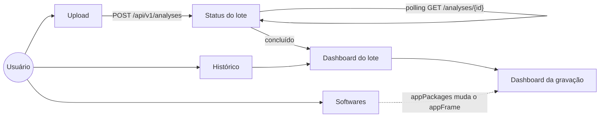

# JMC AI Analyzer Web — v0.1.0

> [!abstract] Em uma frase
> Front-end Angular que envia gravações `.jfr` para a [JMC AI Analyzer API](../../../jmc-ai-analyzer-api/.spec/0.1.0/spec.md) e mostra, para cada lote e cada gravação, **o que precisa ser arrumado**: diagnóstico priorizado, onde está no código, o que fazer, e as métricas que sustentam isso.

> [!info] Como usar esta documentação
> Esta pasta é a **fonte de verdade** antes do SDD do front. Quando as notas estiverem com `status: aprovado`, geramos `.spec/0.1.0/spec.md`, `plan.md` e `tasks.md` na raiz deste repositório.
> O contrato da API é o SDD do back-end (`jmc-ai-analyzer-api/.spec/0.1.0/spec.md`, §6) e o OpenAPI em `/v3/api-docs`.

## Mapa

| # | Nota | Vira no SDD |
|---|---|---|
| 01 | [[01 Visão geral e escopo]] | `spec.md` |
| 02 | [[02 Arquitetura]] | `plan.md` |
| 03 | [[03 Requisitos]] | `spec.md` |
| 04 | [[04 Telas e fluxos]] | `spec.md` |
| 05 | [[05 Integração com a API]] | `spec.md` + `plan.md` |
| 06 | [[06 Visualizações]] | `spec.md` + `plan.md` |
| 07 | [[07 Infraestrutura e qualidade]] | `plan.md` + `tasks.md` |
| 08 | [[08 Decisões e questões]] | todas |
| 09 | [[09 Identidade visual]] | `spec.md` + `plan.md` |

## Fluxo principal

## Status das notas

- [x] [[01 Visão geral e escopo]] revisada
- [x] [[02 Arquitetura]] revisada
- [x] [[03 Requisitos]] revisada
- [x] [[04 Telas e fluxos]] revisada
- [x] [[05 Integração com a API]] revisada
- [x] [[06 Visualizações]] revisada
- [x] [[07 Infraestrutura e qualidade]] revisada
- [ ] [[09 Identidade visual]] revisada
- [x] [[08 Decisões e questões#Questões respondidas|Questões]] respondidas
