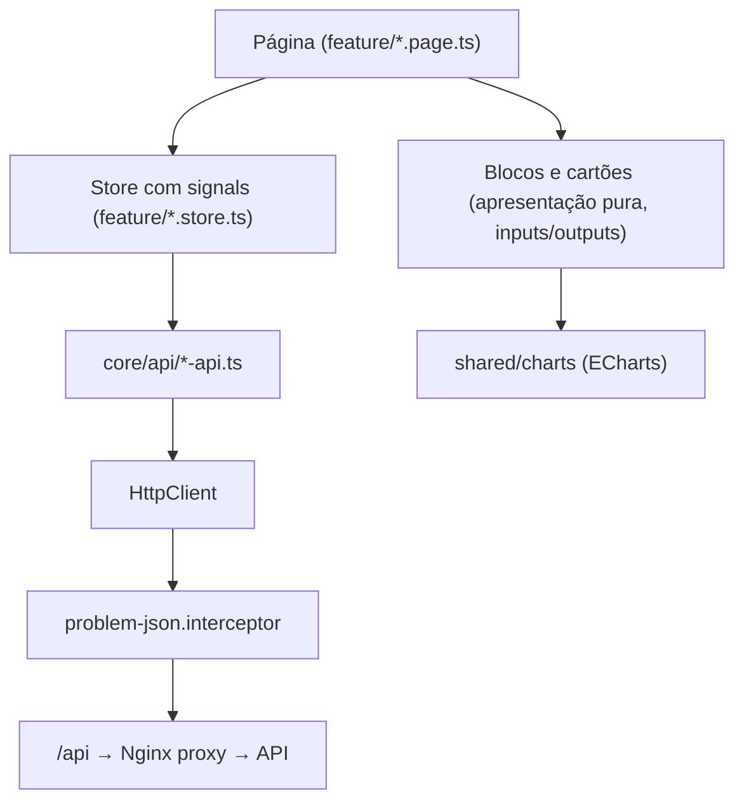

# Arquitetura

Voltar: [[00 Índice]]

## Stack

| Item | Escolha | Observação |
|---|---|---|
| Framework | **Angular 22.2** | standalone components, **signals**, controle de fluxo `@if`/`@for`, zoneless |
| Linguagem | TypeScript (versão da Angular CLI 22) | `strict: true` |
| UI | **Angular Material 22** | tema M3 com claro e escuro |
| Gráficos | **ngx-echarts 22** + **ECharts 6** | séries, barras e gauge; carregamento sob demanda |
| HTTP | `HttpClient` + `httpResource` / signals | interceptor de erros `problem+json` |
| Tipos da API | **openapi-typescript 7** | gera `api.d.ts` a partir do `/v3/api-docs` da API |
| Testes unitários | **Vitest 5** (runner padrão da CLI) | cobertura com v8 |
| Testes E2E | **Playwright 1.65** | rodando contra a API real no Compose |
| Lint | **angular-eslint 22** + Prettier | regras alinhadas ao Sonar |
| Servidor | **Nginx** (imagem `nginx:alpine`) | serve o build e faz proxy de `/api` para a API |

> [!note] Versões
> Conferidas no npm em 2026-11-17. O SDD fixa as versões exatas no `package.json`.

## Estrutura de pastas

Mesma filosofia da API: pastas por responsabilidade e, dentro delas, subpastas por assunto.

```text
src/
├── main.ts · app.config.ts · app.routes.ts
├── app/
│   ├── core/                     infraestrutura transversal (singleton)
│   │   ├── api/                  clientes HTTP por recurso: analyses-api, recordings-api, software-api
│   │   │   └── generated/        api.d.ts gerado pelo openapi-typescript (não editar)
│   │   ├── interceptors/         problem-json.interceptor (erro → ApiError)
│   │   ├── errors/               ApiError, mensagens pt-BR por code
│   │   ├── layout/               shell: toolbar, navegação lateral, tema
│   │   └── config/               runtime-config (URL base, intervalo de polling)
│   ├── shared/                   reutilizável, sem regra de negócio
│   │   ├── components/           health-badge, priority-chip, stack-trace, empty-state, bytes/duração
│   │   ├── charts/               time-series-chart, ranking-bar-chart, gauge-chart (wrappers do ECharts)
│   │   └── pipes/                bytes, duration, percent-fraction, relative-time
│   └── features/                 uma pasta por tela (lazy-loaded)
│       ├── upload/
│       ├── batch-status/
│       ├── batch-dashboard/
│       ├── recording-dashboard/
│       │   └── blocks/           diagnosis, coverage, cpu, heap, gc, threads, locks, hot-methods,
│       │                         allocation, exceptions, io, leaks, thread-cpu, findings, metadata
│       ├── history/
│       └── software/
└── styles/                       tema Material, tokens de cor de prioridade e saúde
```

- Cada **feature** tem `*.page.ts` (rota), componentes de apresentação e um `*.store.ts` (estado com signals).
- Os **blocos do dashboard** são compartilhados entre o dashboard da gravação e o do lote; o do lote só acrescenta `recordingIds` e o comparativo.

## Camadas



| Camada | Regra |
|---|---|
| Página | Lê parâmetros da rota, chama o store, compõe blocos. Sem `HttpClient` direto. |
| Store | `signal`/`computed` com o estado da tela; expõe `loading`, `error` e dados. |
| Cliente da API | Uma classe por recurso, tipada com os tipos gerados. Retorna `Observable` ou `httpResource`. |
| Blocos e componentes | `ChangeDetectionStrategy.OnPush`, só `input()`/`output()`, sem chamadas HTTP. |

## Integração com a API

- **Mesma origem**: o Nginx do front faz proxy de `/api/` e `/actuator/health` para `http://api:8080`. A API **não precisa de CORS**.
- **Desenvolvimento**: `ng serve` com `proxy.conf.json` apontando `/api` para `http://localhost:8080`.
- **Tipos**: `npm run api:types` gera `core/api/generated/api.d.ts` a partir do OpenAPI da API. O arquivo é versionado, e um teste de contrato falha se ele estiver desatualizado. Ver [[05 Integração com a API#Tipos gerados]].

## Rotas

| Rota | Tela | Observação |
|---|---|---|
| `/` | redireciona para `/upload` | |
| `/upload` | Upload | |
| `/batches/:batchId` | Status do lote | polling enquanto `PROCESSING` |
| `/batches/:batchId/dashboard` | Dashboard do lote | `?topN=` |
| `/recordings/:recordingId` | Dashboard da gravação | `?topN=` e `#bloco` para âncora |
| `/history` | Histórico | `?software=&page=&size=` |
| `/software` | Softwares | |
| `**` | Não encontrado | |

Os filtros vivem na **query string**, para que um link copiado reabra a mesma visão.
