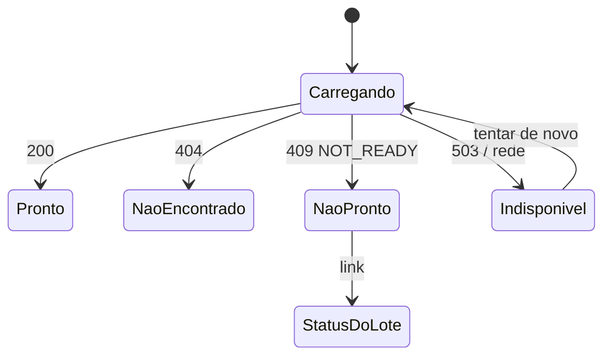

# Telas e fluxos

Voltar: [[00 Índice]] · Requisitos: [[03 Requisitos]]

> [!note] Wireframes
> Os esboços abaixo definem **hierarquia e conteúdo**, não o visual final. O visual segue o tema Material com os tokens de [[06 Visualizações#Cores e tokens]].

## Shell

```text
┌──────────────────────────────────────────────────────────────────────┐
│ [logo] JMC AI Analyzer                     ● API ok   [🖥 Tema]      │  ← barra superior fixa
├──────────────┬───────────────────────────────────────────────────────┤
│ ⤒ Upload     │                                                       │
│ ↺ Histórico  │        (conteúdo da rota — a ÚNICA área que rola)     │
│ ▦ Softwares  │                                                       │
│              │                                                       │
│ ◧ Recolher   │                                                       │  ← menu lateral fixo
└──────────────┴───────────────────────────────────────────────────────┘
```

> [!important] Menus fixos: só o meio rola
> A página nunca rola. A barra superior e o menu ficam parados e **só a área de conteúdo rola**. Âncoras (`#cpu`), "voltar ao topo" ao trocar de tela e a posição ao voltar no histórico continuam funcionando, porque o roteador rola essa área e não a janela.

| Largura | Menu |
|---|---|
| ≥ 1024 px | lateral com ícone + rótulo; botão **Recolher menu** deixa só os ícones (a escolha fica salva no navegador) |
| 640–1023 px | trilho só com ícones (rótulo vira dica e nome acessível) |
| < 640 px (celular) | **barra inferior** com ícone + rótulo; a barra superior mostra só o logo, o ponto de saúde da API e o botão de tema |

- Ícones próprios em SVG (traço, 24×24), sem fonte de ícones nem CDN.
- Ao entrar numa tela, o conteúdo aparece com um leve deslize; cartões e linhas entram em cascata. Tudo some com `prefers-reduced-motion`.

## Upload

```text
Enviar gravações JFR
┌──────────────────────────────────────────────┐
│   Arraste arquivos .jfr aqui ou  [Escolher]  │
└──────────────────────────────────────────────┘
 app-1.jfr   1,4 MB   ✓
 dump.txt    3 KB     ✗ não é .jfr                          [remover]

Software*   [billing-service      ▾]   (minúsculas, números e hífen)
Versão      [1.4.2      ]   Ambiente [PROD ▾]
Descrição   [lentidão no fechamento às 14h          ]  27/500

                                   [Enviar 1 arquivo]  ▓▓▓▓▓░░ 62% [Cancelar]
```

## Status do lote

```text
billing-service 1.4.2 · PROD · "lentidão às 14h"              ⟳ PROCESSING
──────────────────────────────────────────────────────────────────────────
Arquivo          Tamanho  Estado        Início    Fim       
app-1.jfr        1,4 MB   ✓ Concluído   14:02:11  14:02:13  [Ver dashboard]
app-2.jfr        1,5 MB   ⟳ Processando 14:02:11  —
broken.jfr       0,5 MB   ✗ Falhou: arquivo JFR ilegível (PARSE_ERROR)
──────────────────────────────────────────────────────────────────────────
                                           [Ver dashboard do lote] (ao concluir)
```

## Dashboard da gravação

```text
GRAVAÇÃO · billing-service 1.4.2                                   Itens por ranking [10 ▾]
app-1.jfr
HotSpot 21 · 60 s gravados · Ver o lote completo →
┌─────────────────┬───────────┬───────────┬───────────┬──────────┬──────────┐
│ ( 8 ) Crítico   │ Prio alta │ Prio média│ Prio baixa│ Duração  │ Eventos  │  ← resumo de relance
│      nota saúde │ 1         │ 5         │ 2         │ 60 s     │ 36.758   │
└─────────────────┴───────────┴───────────┴───────────┴──────────┴──────────┘
[O que arrumar] Cobertura  CPU  Heap  GC  Threads  Hot methods  …  Metadados   ← barra de seções fixa
═══════════════════════════════════════════════════════════════════════════════
🔧 O QUE ARRUMAR (8)                     [Todas 8] [ALTA 1] [MÉDIA 5] [BAIXA 2]  ← filtro
┃ ▲ ALTA · AMBIENTE                                                            
┃ Outros processos consumindo CPU                                              
┃ 43% da CPU foi usada por outros processos (19:51:00–19:51:13)                
┃ ┌ → COMO ARRUMAR ───────────────────────────────────────────────────────┐   
┃ │ Grave num ambiente isolado ou limite os outros processos.             │   
┃ └───────────────────────────────────────────────────────────────────────┘   
┃ ver dados ↓                                                                  
┃ ■ MÉDIA · MEMÓRIA   Taxa de alocação alta                                    
┃ 📍 seu código: HexaUtil.converteString:23  [Copiar]   ▸ pilha (5)            
COBERTURA DA GRAVAÇÃO                                   10 de 12 domínios com dados
 ✗ EXCEPTIONS  jdk.JavaExceptionThrow desabilitado → habilite ...
 $ -XX:StartFlightRecording=settings=profile,...                    [Copiar comando]
┌ CPU  [JVM média 2%][pico 4%]… ┐┌ HEAP [pico 352 MB de 768 MB]… ┐   ← 2 colunas em telas ≥ 1200 px
└───────────────────────────────┘└───────────────────────────────┘
┌ GC ───────────────────────────┐┌ THREADS ──────────────────────┐
HOT METHODS · ALOCAÇÃO · LOCKS · EXCEÇÕES · I/O · VAZAMENTO · CPU POR THREAD  (largura total)
ACHADOS DO JMC (68 regras)                                         [▾]
METADADOS                                                          [▾]
```

- O **resumo** responde "está grave?" antes de qualquer gráfico; o cartão "Prioridade alta" leva direto ao diagnóstico.
- A **barra de seções** fica presa no topo da área de conteúdo, marca a seção visível e rola sozinha no celular.
- Cada bloco tem um **resumo em números** (chips) acima do gráfico (acessibilidade e leitura rápida).
- Os blocos indisponíveis mostram "sem dados nesta gravação; veja a cobertura".
- Tabelas largas rolam para os lados **dentro do próprio cartão**, nunca a página.

## Dashboard do lote

Igual ao da gravação, com estas mudanças:

```text
LOTE · DEV  billing-service 1.4.2                       resumo: saúde · prioridades · gravações · tempo
⚠ 1 gravação ficou fora: broken.jfr (PARSE_ERROR)
O QUE ARRUMAR
│ ■ MÉDIA · CONFIG_JVM  JVM limitada a menos processadores...  em 3 de 3 gravações ▾
COMPARATIVO
 Gravação     Duração  CPU média  Pausa máx GC  Saúde  Itens ALTA
 app-1.jfr    60 s     2,0%       70 ms         8      1          [abrir]
 app-2.jfr    60 s     2,3%       65 ms         16     1          [abrir]
CPU  [uma linha por gravação]
```

## Histórico

```text
Histórico                          Software [todos ▾]      20 por página ▾
Data            Software         Versão  Amb.  Arq.  Estado     Saúde  ALTA  WARNING
17/11 14:02     billing-service  1.4.2   PROD  3     PARTIAL    [8]    1     7
17/11 11:30     orders           —       HML   1     COMPLETED  [64]   0     2
                                                   ‹ 1 2 3 ›
```

## Softwares

```text
Softwares
Nome             Retenção  Pacotes da aplicação         Lotes  Último lote   Versão
billing-service  90 dias   com.empresa, br.com.cliente  12     17/11 14:02   1.4.2   [editar]

Editar billing-service
 Retenção (dias) [ 90 ]
 Pacotes         [com.empresa ✕] [br.com.cliente ✕] [+ adicionar]
 ⓘ Os pacotes definem o "seu código" nas pilhas, também nas análises antigas.
                                                     [Cancelar] [Salvar]
```

## Fluxo de erros e estados


