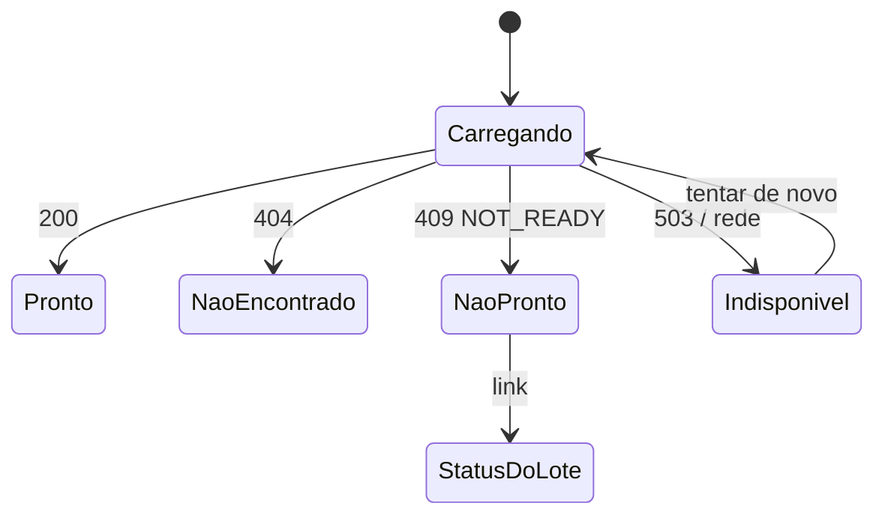

# Telas e fluxos

Voltar: [[00 Índice]] · Requisitos: [[03 Requisitos]]

> [!note] Wireframes
> Os esboços abaixo definem **hierarquia e conteúdo**, não o visual final. O visual segue o tema Material com os tokens de [[06 Visualizações#Cores e tokens]].

## Shell

```text
┌──────────────────────────────────────────────────────────────────────┐
│ ☰  JMC AI Analyzer                          ● API ok    ◐ tema      │
├──────────────┬───────────────────────────────────────────────────────┤
│ ⇪ Upload     │                                                       │
│ ☰ Histórico  │                (conteúdo da rota)                     │
│ ⚙ Softwares  │                                                       │
└──────────────┴───────────────────────────────────────────────────────┘
```

## Upload

```text
Enviar gravações JFR
┌──────────────────────────────────────────────┐
│   Arraste arquivos .jfr aqui ou  [Escolher]  │
└──────────────────────────────────────────────┘
 app-1.jfr   1,4 MB   ✓
 dump.txt    3 KB     ✗ não é .jfr                          [remover]

Software*   [billing-service      ▾]   (minúsculas, números e hífen)
Versão      [1.4.2      ]   Ambiente [PROD ▾]
Descrição   [lentidão no fechamento às 14h          ]  27/500

                                   [Enviar 1 arquivo]  ▓▓▓▓▓░░ 62% [Cancelar]
```

## Status do lote

```text
billing-service 1.4.2 · PROD · "lentidão às 14h"              ⟳ PROCESSING
──────────────────────────────────────────────────────────────────────────
Arquivo          Tamanho  Estado        Início    Fim       
app-1.jfr        1,4 MB   ✓ Concluído   14:02:11  14:02:13  [Ver dashboard]
app-2.jfr        1,5 MB   ⟳ Processando 14:02:11  —
broken.jfr       0,5 MB   ✗ Falhou: arquivo JFR ilegível (PARSE_ERROR)
──────────────────────────────────────────────────────────────────────────
                                           [Ver dashboard do lote] (ao concluir)
```

## Dashboard da gravação

```text
app-1.jfr · billing-service 1.4.2 · HotSpot 21 · 60 s        [ 8 ] saúde   topN [10 ▾]
═══════════════════════════════════════════════════════════════════════════════
O QUE ARRUMAR (8)                                   ALTA 1 · MÉDIA 5 · BAIXA 2
┌─────────────────────────────────────────────────────────────────────────────┐
│ ▲ ALTA · AMBIENTE   Outros processos consumindo CPU                         │
│   43% da CPU foi usada por outros processos (19:51:00–19:51:13)             │
│   ➜ Grave num ambiente isolado ou limite os outros processos.  [ver dados]  │
├─────────────────────────────────────────────────────────────────────────────┤
│ ■ MÉDIA · MEMÓRIA   Taxa de alocação alta                                   │
│   1,7 GB/s; o tipo mais alocado é java.lang.String                          │
│   📍 seu código: HexaUtil.converteString:23        [pilha ▸]                │
│   ➜ Reduza alocações temporárias no ponto indicado.            [ver dados]  │
└─────────────────────────────────────────────────────────────────────────────┘
COBERTURA DA GRAVAÇÃO
 ✗ EXCEPTIONS  jdk.JavaExceptionThrow desabilitado → habilite ...
 ◐ HOT_METHODS 220 amostras em 60 s → grave por mais tempo ...
 $ -XX:StartFlightRecording=settings=profile,...                    [copiar]
═══════════════════════════════════════════════════════════════════════════════
CPU            [série JVM usuário / sistema / máquina]     média 2% · pico 4%
HEAP           [série usado / comprometido]                pico 352 MB de 768 MB
GC             24 coletas · p95 64 ms · máx 70 ms · 1,2%   [top pausas]
THREADS        pico 32 · daemon 26 · criadas 4 · encerradas 2
HOT METHODS    [barras: método · amostras · %]   📍 appFrame por linha
ALOCAÇÃO       [barras por classe · bytes]       📍 appFrame por linha
LOCKS · EXCEÇÕES · I/O · VAZAMENTO · CPU POR THREAD   (mesmo padrão)
ACHADOS DO JMC (68 regras)                                         [expandir ▸]
METADADOS                                                          [expandir ▸]
```

- Cada bloco tem um **resumo em texto** acima do gráfico (acessibilidade e leitura rápida).
- Os blocos indisponíveis ficam recolhidos e mostram "sem dados nesta gravação; veja a cobertura".

## Dashboard do lote

Igual ao da gravação, com estas mudanças:

```text
LOTE billing-service 1.4.2 · 3 gravações (2 concluídas) · 3 min       [ 8 ] pior saúde
⚠ 1 gravação ficou fora: broken.jfr (PARSE_ERROR)
O QUE ARRUMAR
│ ■ MÉDIA · CONFIG_JVM  JVM limitada a menos processadores...  em 3 de 3 gravações ▾
COMPARATIVO
 Gravação     Duração  CPU média  Pausa máx GC  Saúde  Itens ALTA
 app-1.jfr    60 s     2,0%       70 ms         8      1          [abrir]
 app-2.jfr    60 s     2,3%       65 ms         16     1          [abrir]
CPU  [uma linha por gravação]
```

## Histórico

```text
Histórico                          Software [todos ▾]      20 por página ▾
Data            Software         Versão  Amb.  Arq.  Estado     Saúde  ALTA  WARNING
17/11 14:02     billing-service  1.4.2   PROD  3     PARTIAL    [8]    1     7
17/11 11:30     orders           —       HML   1     COMPLETED  [64]   0     2
                                                   ‹ 1 2 3 ›
```

## Softwares

```text
Softwares
Nome             Retenção  Pacotes da aplicação         Lotes  Último lote   Versão
billing-service  90 dias   com.empresa, br.com.cliente  12     17/11 14:02   1.4.2   [editar]

Editar billing-service
 Retenção (dias) [ 90 ]
 Pacotes         [com.empresa ✕] [br.com.cliente ✕] [+ adicionar]
 ⓘ Os pacotes definem o "seu código" nas pilhas, também nas análises antigas.
                                                     [Cancelar] [Salvar]
```

## Fluxo de erros e estados


